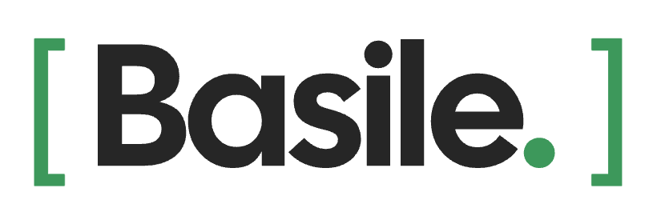

<p align="center">
  <a href="https://www.basile.cc">
    <picture>
      <source media="(prefers-color-scheme: dark)" srcset="assets/basile-wordmark-white.png">
      
    </picture>
  </a>
</p>

# Basile MCP : la base de données B2B française dans Claude, ChatGPT et Cursor

**Basile MCP est le serveur MCP de base de données B2B française** : il connecte Claude, ChatGPT, Cursor, VS Code et tout client compatible MCP à [Basile](https://www.basile.cc), pour trouver des entreprises françaises, leurs dirigeants et leurs contacts en une phrase. Vous demandez une liste en français, l'IA interroge Basile, compte, filtre et vous rend le fichier.

**Français** · [English](#english) · [Outils](docs/TOOLS.md) · [Exemples de configuration](examples/) · [Support](#support)

> [!NOTE]
> **Service en ligne.** Le serveur est hébergé par Basile et répond à `https://mcp.basile.cc/mcp` : rien à installer, rien à mettre à jour. Pour vérifier qu'il tourne, ouvrez [mcp.basile.cc/health](https://mcp.basile.cc/health), qui répond `"ok": true`. Avant la connexion, un `401` est normal : c'est lui qui lance le parcours OAuth.

| | |
|---|---|
| Adresse du serveur | `https://mcp.basile.cc/mcp` |
| Transport | Streamable HTTP (serveur distant, rien à installer) |
| Connexion | OAuth avec votre compte Basile, sans clé d'API |
| Facturation | comme une clé d'API : 1 crédit par fiche renvoyée, comptages gratuits |
| Outils | recherche et comptage, fiches, export, enrichissement ([liste complète](docs/TOOLS.md)) |
| Registre officiel MCP | `cc.basile/basile` ([`server.json`](server.json)) |
| Site | [www.basile.cc](https://www.basile.cc) |

## Sommaire

- [Ce que contient Basile](#ce-que-contient-basile)
- [Exemples de demandes](#exemples-de-demandes)
- [Authentification et facturation](#authentification-et-facturation)
- [Démarrage rapide](#démarrage-rapide) : [Claude](#claude-claudeai-claude-desktop-applications-mobiles), [Claude Code](#claude-code), [ChatGPT](#chatgpt), [Cursor](#cursor), [VS Code](#vs-code-github-copilot), [Devin Desktop](#devin-desktop-anciennement-windsurf), [clients stdio](#clients-qui-ne-lancent-que-des-serveurs-locaux-mcp-remote)
- [Outils du serveur MCP](#outils-du-serveur-mcp)
- [Garde-fous](#garde-fous)
- [Offres et limites](#offres-et-limites)
- [Questions fréquentes](#questions-fréquentes)
- [Support](#support)
- [Licence](#licence)
- [English](#english)

## Ce que contient Basile

Basile est une base de données B2B construite pour la France. Sa force : elle **croise** plusieurs sources pour chaque entreprise et chaque personne, là où beaucoup de bases n'en ont qu'une (LinkedIn seul, ou le registre légal seul).

| Source | Ce que vous obtenez |
|---|---|
| Registre légal des entreprises | SIREN, raison sociale, code NAF, forme juridique, capital, date de création, effectif, siège, dirigeants et mandats, entrepreneurs individuels compris |
| Procédures et conventions | procédures collectives (liquidation, redressement, sauvegarde) d'après les jugements publiés au BODACC, convention collective (IDCC), numéro de TVA intracommunautaire |
| Comptes annuels | chiffre d'affaires, résultat et autres chiffres publiés, sur la fiche entreprise |
| LinkedIn | profils (poste, séniorité, fonctions, compétences, langues, formation, ancienneté) et pages entreprises |
| Google Maps | établissements et points de vente : catégorie, adresse, téléphone, note, nombre d'avis |
| Sites web | e-mails et téléphones publiés par les entreprises, technologies utilisées (Shopify, WordPress…) |

Tout est rapproché : une fiche Google Maps mène à la société du registre, à ses dirigeants et à leurs profils LinkedIn. Et quand une coordonnée manque, l'enrichissement trouve l'e-mail professionnel ou le numéro de portable d'une personne.

**Filtres sur les personnes** : secteur d'activité, intitulé de poste, mandat légal (gérant, président, directeur général…), séniorité, fonction, compétences, langues, formation, ancienneté au poste, taille de l'entreprise, ville, région, pays, profil LinkedIn.

**Filtres sur les entreprises** : activité, code NAF, nom, domaine web, département, code postal, ville, région, effectif, capital, forme juridique, date de création, création récente, procédure collective, convention collective, technologies du site, note et avis Google, ouverture le dimanche, présence d'un e-mail, entreprise active ou cessée.

## Exemples de demandes

Écrivez simplement ce que vous cherchez. L'IA choisit les bons outils, compte d'abord (gratuit), puis extrait ce dont vous avez besoin.

**Trouver des prospects**

- « Combien y a-t-il d'entreprises de plomberie actives en Haute-Garonne ? Exporte-les en CSV avec leur site web et leur téléphone. »
- « Liste les e-commerçants français sous Shopify qui ont entre 10 et 50 salariés. »
- « Trouve les restaurants d'Auvergne-Rhône-Alpes notés 4,5 ou plus sur Google, avec au moins 100 avis. »
- « Liste les sociétés de conseil en informatique créées ces trois derniers mois en Île-de-France. »
- « Quelles entreprises du BTP du Rhône sont en redressement judiciaire en cours ? »

**Trouver des dirigeants et des décideurs**

- « Trouve les dirigeants (CEO, DG, présidents) des éditeurs de logiciels de 50 à 200 salariés en Île-de-France. »
- « Qui sont les gérants en poste des agences immobilières de Bordeaux ? »
- « Pour cette liste de SIREN, retrouve les dirigeants actuels de chaque société. »
- « Trouve les directeurs commerciaux des entreprises industrielles de plus de 100 salariés dans les Hauts-de-France. »

**Enrichir des contacts**

- « Trouve l'e-mail professionnel de [prénom nom], directrice marketing chez [société]. »
- « Pour ces 30 dirigeants, trouve leur e-mail et leur portable. Annonce-moi d'abord le coût maximal. »
- « Quel est mon solde d'enrichissement ? »

## Authentification et facturation

- **Adresse** : `https://mcp.basile.cc/mcp`, en Streamable HTTP.
- **Connexion** : OAuth. Au premier appel, votre client ouvre la page de connexion Basile ; vous vous connectez avec votre compte habituel et vous autorisez l'accès. Aucune clé à copier, à coller ni à stocker : le client s'enregistre tout seul (enregistrement dynamique OAuth, PKCE).
- **Votre compte** : le serveur agit en votre nom, avec votre offre, vos crédits et vos plafonds.
- **Offre requise** : une offre avec accès API (offre API ou Agence, voir [Offres et limites](#offres-et-limites)). Sans elle, seul l'enrichissement payé sur le solde fonctionne.
- **Facturation** : le serveur MCP est facturé comme une clé d'API. Chaque fiche renvoyée par une recherche consomme 1 crédit, et la consultation d'une fiche complète 1 crédit par appel. **Les comptages sont gratuits** et exacts : demandez toujours combien il y a de résultats avant d'extraire.
- **Enrichissement** : payé sur le solde d'enrichissement, 0,05 € HT par e-mail trouvé, 0,50 € HT par numéro trouvé, rien si rien n'est trouvé. Une coordonnée déjà trouvée par votre compte est resservie gratuitement.
- **Pour les développeurs de clients** : un appel sans jeton reçoit un `401` dont l'en-tête `WWW-Authenticate` désigne les métadonnées de ressource protégée (RFC 9728), `https://mcp.basile.cc/.well-known/oauth-protected-resource`. Le client s'enregistre ensuite par enregistrement dynamique (RFC 7591), en client public avec PKCE (S256). Portée : `basile:read`.

## Démarrage rapide

Le serveur est hébergé : il suffit de déclarer son adresse dans votre client, puis de vous connecter avec votre compte Basile. Des fichiers prêts à copier sont dans [examples/](examples/). Les libellés des menus cités ci-dessous peuvent varier selon la version et la langue de votre client.

### Claude (claude.ai, Claude Desktop, applications mobiles)

Basile s'ajoute comme **connecteur personnalisé** :

1. Ouvrez **Customize**, puis **Connectors**.
2. Cliquez sur **+ Add**, puis **Add custom connector**.
3. Nom : `Basile`. URL : `https://mcp.basile.cc/mcp`. Cliquez sur **Continue**.
4. Gardez l'authentification détectée (OAuth), cliquez sur **Add**, puis connectez-vous avec votre compte Basile.
5. Dans une conversation, activez Basile avec le bouton **+**, puis **Connectors**.

Le connecteur ajouté depuis votre compte est disponible sur claude.ai, dans Claude Desktop et sur mobile. Sur les offres Team et Enterprise, un propriétaire l'ajoute d'abord dans **Organization settings**, **Connectors** (**Add**, **Custom**, **Web**), puis chaque membre clique sur **Connect**. L'offre gratuite de Claude est limitée à un connecteur personnalisé.

### Claude Code

```bash
claude mcp add --transport http basile https://mcp.basile.cc/mcp
```

Lancez ensuite `/mcp` dans Claude Code, choisissez `basile` et connectez-vous dans le navigateur. Ajoutez `--scope user` pour l'avoir dans tous vos projets, ou `--scope project` pour écrire un fichier `.mcp.json` partagé avec votre équipe ([exemple](examples/claude-code/.mcp.json)).

### ChatGPT

Les serveurs MCP personnalisés passent par le **mode développeur** de ChatGPT, sur le web et avec une offre payante.

1. Dans **Settings**, **Apps**, **Advanced settings**, activez **Developer mode**.
2. Cliquez sur **Create app**. Nom : `Basile`. URL : `https://mcp.basile.cc/mcp`. Authentification : **OAuth**.
3. Connectez-vous avec votre compte Basile et autorisez l'accès.
4. Dans une nouvelle conversation, choisissez Basile parmi les outils du mode développeur.

ChatGPT demande une confirmation avant les outils qui consomment (export, enrichissement). Sur les offres Business et Enterprise, un administrateur doit parfois autoriser les applications personnalisées. Ces menus changent souvent : si vous ne les trouvez pas, cherchez « Developer mode » dans les réglages de ChatGPT.

### Cursor

Dans `~/.cursor/mcp.json` (tous vos projets) ou `.cursor/mcp.json` (un seul projet, [exemple](examples/cursor/.cursor/mcp.json)) :

```json
{
  "mcpServers": {
    "basile": {
      "url": "https://mcp.basile.cc/mcp"
    }
  }
}
```

Ouvrez ensuite les réglages MCP de Cursor et lancez la connexion du serveur `basile`. Pour une installation en un clic, collez ce lien dans votre navigateur :

```text
cursor://anysphere.cursor-deeplink/mcp/install?name=basile&config=eyJ1cmwiOiJodHRwczovL21jcC5iYXNpbGUuY2MvbWNwIn0=
```

### VS Code (GitHub Copilot)

Dans `.vscode/mcp.json` (espace de travail, [exemple](examples/vscode/.vscode/mcp.json)) ou dans le `mcp.json` de votre profil (commande **MCP: Open User Configuration**) :

```json
{
  "servers": {
    "basile": {
      "type": "http",
      "url": "https://mcp.basile.cc/mcp"
    }
  }
}
```

Ou en ligne de commande (macOS, Linux) :

```bash
code --add-mcp '{"name":"basile","type":"http","url":"https://mcp.basile.cc/mcp"}'
```

Au démarrage du serveur, VS Code vous propose de vous connecter. Utilisez ensuite Basile depuis Copilot Chat en mode agent.

### Devin Desktop (anciennement Windsurf)

Devin Desktop lit ses serveurs MCP dans `~/.config/devin/mcp_config.json` sur macOS et Linux (ou `$XDG_CONFIG_HOME/devin/mcp_config.json`), et dans `%APPDATA%\devin\mcp_config.json` sous Windows. Le même fichier sert à l'agent Devin Local et à l'agent Cascade ; depuis Cascade, il s'ouvre par le menu **…** du panneau, puis **Open MCP config file** ([exemple](examples/devin-desktop/mcp_config.json)).

```json
{
  "mcpServers": {
    "basile": {
      "url": "https://mcp.basile.cc/mcp"
    }
  }
}
```

Ou en ligne de commande, avec la CLI de Devin :

```bash
devin mcp add -s user basile https://mcp.basile.cc/mcp
devin mcp login basile
```

La connexion se fait par OAuth au premier usage. Les anciennes versions de Windsurf lisent `~/.codeium/windsurf/mcp_config.json` : si l'entrée n'y est pas reconnue, remplacez `url` par `serverUrl`.

### Clients qui ne lancent que des serveurs locaux (mcp-remote)

Si votre client ne sait lancer que des serveurs locaux (stdio), passez par `mcp-remote`, un pont open source qui n'est pas édité par Basile. Il demande Node.js 18 ou plus récent ([exemple](examples/mcp-remote/claude_desktop_config.json)).

```json
{
  "mcpServers": {
    "basile": {
      "command": "npx",
      "args": ["-y", "mcp-remote", "https://mcp.basile.cc/mcp"]
    }
  }
}
```

Au premier lancement, la page de connexion Basile s'ouvre dans votre navigateur. Quand votre client gère les serveurs distants, préférez la connexion directe décrite plus haut.

### Autres clients

Tout client qui gère les serveurs MCP distants (Streamable HTTP et OAuth) fonctionne avec la même adresse : `https://mcp.basile.cc/mcp`.

## Outils du serveur MCP

<!-- outils:debut (généré par scripts/generate-tools-md.mjs) -->
Le serveur expose **11 outils** en **4 familles**. Chacun annonce son coût dans sa description, pour que l'IA puisse vous prévenir avant de consommer. Le détail de chaque outil, paramètres et annotations compris, est dans [docs/TOOLS.md](docs/TOOLS.md).

**Recherche et comptage** : compter gratuitement, chercher des personnes et des entreprises, trouver les valeurs valides des filtres. ([détail](docs/TOOLS.md#recherche-et-comptage))

| Outil | Ce qu'il fait | Paramètres principaux | Coût |
| --- | --- | --- | --- |
| `basile_count` | Compte les résultats d'une recherche de personnes ou d'entreprises. Total exact, et pour les entreprises le nombre de points de vente Google. | `kind`, `filters` | Gratuit |
| `basile_search_people` | Cherche des personnes : dirigeants du registre légal et profils LinkedIn. 25 fiches par défaut, 1 000 au plus par appel, avec pagination. | `filters`, `limit`, `paginationToken` | 1 crédit par fiche renvoyée |
| `basile_search_companies` | Cherche des entreprises : registre légal, pages LinkedIn et fiches Google Maps. | `filters`, `limit`, `paginationToken` | 1 crédit par fiche renvoyée |
| `basile_activity_suggest` | Trouve l'identifiant d'une activité à partir d'un mot (« boulangerie », « avocat »), en réunissant codes NAF, catégories Google et secteurs LinkedIn. | `q`, `limit` | Gratuit |
| `basile_suggest` | Propose les valeurs valides d'un filtre : villes, intitulés de poste, employeurs, écoles, formes juridiques, SIREN… | `field`, `q`, `limit` | Gratuit |

**Fiches** : la fiche complète d'une personne ou d'une entreprise, toutes sources réunies. ([détail](docs/TOOLS.md#fiches))

| Outil | Ce qu'il fait | Paramètres principaux | Coût |
| --- | --- | --- | --- |
| `basile_get_entity` | Fiche complète d'une personne ou d'une entreprise : toutes les sources, registre, procédures, conventions collectives, TVA intracommunautaire, comptes publiés. | `kind`, `id`, `full` | 1 crédit par appel |

**Export** : export CSV complet, dans la conversation jusqu'à 500 lignes, en fichier à télécharger au-delà. ([détail](docs/TOOLS.md#export))

| Outil | Ce qu'il fait | Paramètres principaux | Coût |
| --- | --- | --- | --- |
| `basile_export` | Export CSV complet (70 colonnes pour les entreprises, 92 pour les personnes), par filtres ou par liste d'identifiants. Jusqu'à 500 lignes dans la conversation, au-delà un fichier à télécharger. Mode `locations` : une ligne par point de vente Google. | `kind`, `filters`, `ids`, `mode` | Quota d'export de l'offre, au nombre de lignes |
| `basile_export_status` | Suit un export fichier et rend son lien de téléchargement, valable environ une heure. | `jobId` | Gratuit |

**Enrichissement** : l'e-mail professionnel ou le numéro de portable d'une personne, payé sur le solde d'enrichissement. ([détail](docs/TOOLS.md#enrichissement))

| Outil | Ce qu'il fait | Paramètres principaux | Coût |
| --- | --- | --- | --- |
| `basile_enrich_person` | Trouve l'e-mail professionnel et/ou le numéro de portable d'une personne, présente dans Basile ou non, à partir de son nom et de sa société. Le profil LinkedIn est nécessaire pour le numéro. | `full_name`, `company_name`, `domain`, `linkedin_url`, `find` | 0,05 € HT l'e-mail trouvé, 0,50 € HT le numéro trouvé, rien si introuvable |
| `basile_enrichment_status` | Rend le résultat d'une demande d'enrichissement encore en cours, sans rien relancer ni refacturer. | `id` | Gratuit |
| `basile_enrichment_balance` | Solde d'enrichissement, prix et lien de recharge. | aucun | Gratuit |

<!-- outils:fin -->

Bon à savoir :

- **Comptez avant d'extraire.** `basile_count` est gratuit et exact ; le total renvoyé par une recherche, lui, s'arrête à 100 000.
- **L'enchaînement type** : `basile_activity_suggest` ou `basile_suggest` pour trouver les valeurs de filtre, `basile_count` pour dimensionner, une recherche pour un échantillon, puis `basile_export` pour tout le volume.
- **Un zéro n'est jamais muet.** Quand une recherche par employeur ou par SIREN ne trouve rien d'exact, le serveur tente une récupération (nom nettoyé, SIREN du registre, page LinkedIn de la société) ou explique pourquoi, avec des pistes pour relancer.

## Garde-fous

- **Comptages gratuits.** `basile_count` ne consomme aucun crédit et rend un total exact. Le serveur invite l'IA à compter avant toute recherche ou tout export.
- **Coûts annoncés.** Chaque outil écrit son coût dans sa description : 1 crédit par fiche renvoyée, 1 crédit par fiche complète, quota d'export de l'offre, prix de l'enrichissement. Avant d'enrichir plusieurs personnes, l'IA est invitée à vous annoncer le coût maximal et à attendre votre accord.
- **Confirmation avant de consommer.** Les outils de recherche, de fiche et de suivi sont déclarés en lecture seule (`readOnlyHint: true`). `basile_export` et `basile_enrich_person` sont déclarés comme des outils qui consomment (`readOnlyHint: false`) : votre client peut vous demander de confirmer avant de les lancer.
- **Plafonds.** 1 000 fiches au plus par appel de recherche, 500 lignes au plus dans la conversation, un export fichier plafonné par votre offre, et un plafond de requêtes par jour (voir [Offres et limites](#offres-et-limites)). Le serveur agit avec votre compte : il ne peut pas dépasser votre offre.
- **Rien n'est débité pour rien.** Un enrichissement qui ne trouve rien ne coûte rien, une coordonnée déjà trouvée par votre compte est resservie gratuitement, et une demande rejouée avec le même `request_id` n'est ni relancée ni refacturée. Suivre un export ou un enrichissement en cours est gratuit.
- **Pas d'écriture chez vous.** Le serveur lit la base Basile et ne touche à rien d'autre : il ne modifie ni ne supprime rien dans vos fichiers, vos outils ou votre CRM, et aucun outil n'est destructif (`destructiveHint: false`). Les exports restent dans votre compte Basile, onglet Exports.
- **Aucune clé à stocker.** La connexion passe par OAuth : il n'y a ni jeton ni clé dans vos fichiers de configuration.

## Offres et limites

Le serveur MCP demande une offre avec accès API. Les prix ci-dessous sont les tarifs de lancement affichés sur [www.basile.cc](https://www.basile.cc).

| | Offre API | Offre Agence |
|---|---|---|
| Prix | 79 € HT par mois | 279 € HT par mois |
| Crédits (lignes) par mois | 250 000 | 1 000 000 |
| Lignes par export fichier | 20 000 | 50 000 |
| Requêtes | 5 par seconde, 100 par minute, 2 000 par jour | 100 par seconde, 3 000 par minute, 5 000 par jour |

- L'offre Starter n'inclut pas l'accès API, donc pas le serveur MCP.
- Chaque recherche, comptage ou export compte une requête dans le plafond du jour, remis à zéro à minuit UTC. L'enrichissement n'entre dans aucun de ces plafonds.
- Jusqu'à 500 lignes, l'export arrive directement dans la conversation. Au-delà, Basile construit un fichier et vous donne un lien de téléchargement ; le fichier reste aussi disponible dans l'application, onglet Exports.
- Une recherche se pagine jusqu'à 250 000 fiches. Au-delà, découpez-la (par département, par tranche d'effectif…).
- Besoin de volumes plus élevés : écrivez à contact@basile.cc.

## Questions fréquentes

### Faut-il une clé d'API ?

Non. La connexion se fait par OAuth avec votre compte Basile : votre client ouvre la page de connexion, vous autorisez l'accès, et c'est tout.

### Le comptage est-il vraiment gratuit ?

Oui. `basile_count` ne consomme aucun crédit et rend un total exact. Il compte seulement comme une requête dans le plafond du jour de votre offre.

### Quelle offre faut-il pour utiliser le MCP ?

L'offre API ou l'offre Agence. Un compte qui n'a que du solde d'enrichissement peut utiliser les outils d'enrichissement, mais pas la recherche.

### Mon client affiche « 401 Unauthorized » ou « non autorisé »

C'est normal avant la connexion : cette réponse déclenche le parcours OAuth. Lancez la connexion depuis votre client (par exemple `/mcp` dans Claude Code). Pour vérifier que le service tourne, ouvrez `https://mcp.basile.cc/health`.

### Puis-je exporter plus de 500 lignes ?

Oui. Au-delà de 500 lignes, l'export devient un fichier à télécharger, dans la limite de votre offre (20 000 lignes par export en offre API, 50 000 en offre Agence).

### L'IA peut-elle dépenser mes crédits sans me prévenir ?

Chaque outil annonce son coût, le comptage est gratuit, et les deux outils qui consomment au-delà d'une recherche (`basile_export` et `basile_enrich_person`) sont signalés comme tels à votre client, qui peut vous demander de confirmer. Voir les [garde-fous](#garde-fous).

### Basile couvre-t-il d'autres pays que la France ?

Basile est construit pour le marché français : registre légal français, établissements Google Maps en France, et ses filtres portent sur la France.

### Le code du serveur est-il public ?

Non. Le serveur est hébergé et maintenu par Basile. Ce dépôt contient tout ce qu'il faut pour l'utiliser : la documentation, le fichier [`server.json`](server.json) du registre officiel MCP, la liste des outils ([`tools.json`](tools.json) et [docs/TOOLS.md](docs/TOOLS.md)) et des exemples de configuration.

### Il me manque un filtre : que faire ?

Dites-le-nous : contact@basile.cc, ou une [demande sur ce dépôt](../../issues/new/choose). Basile évolue chaque semaine et vos demandes guident les prochains filtres.

## Support

- **Votre compte, votre offre ou une connexion** : écrivez à contact@basile.cc.
- **Une erreur dans cette documentation ou dans un exemple de configuration** : [ouvrez une issue](../../issues/new/choose).
- **Un filtre ou une donnée qui manque** : [faites une demande](../../issues/new/choose).
- **Une faille de sécurité** : suivez [SECURITY.md](SECURITY.md), sans ouvrir d'issue publique.

## Licence

La documentation et les exemples de configuration de ce dépôt sont publiés sous licence [MIT](LICENSE). Le service Basile lui-même (serveur MCP hébergé, API et données) reste propriétaire : ce dépôt n'en contient pas le code. Le nom et le logo Basile ne sont pas couverts par la licence MIT.

Contact : contact@basile.cc · Sécurité : [SECURITY.md](SECURITY.md) · Nouveautés : [CHANGELOG.md](CHANGELOG.md) · Site : [www.basile.cc](https://www.basile.cc)

---

## English

**Basile MCP is the French B2B database MCP server**: a hosted, remote MCP server that connects Claude, ChatGPT, Cursor, VS Code and any MCP client to [Basile](https://www.basile.cc), so you can find French companies, their executives and their contacts with a plain-language request. Ask for a list, the AI queries Basile, counts, filters and hands you the file.

> [!NOTE]
> **Live service.** The server is hosted by Basile and answers at `https://mcp.basile.cc/mcp`: nothing to install or update. To check that it is running, open [mcp.basile.cc/health](https://mcp.basile.cc/health), which returns `"ok": true`. Before you sign in, a `401` is expected: it starts the OAuth flow.

| | |
|---|---|
| Server URL | `https://mcp.basile.cc/mcp` |
| Transport | Streamable HTTP (remote, nothing to install) |
| Sign-in | OAuth with your Basile account, no API key |
| Billing | same as an API key: 1 credit per record returned, counts are free |
| Tools | search and count, records, export, enrichment ([full list](docs/TOOLS.md#english)) |
| Official MCP Registry | `cc.basile/basile` ([`server.json`](server.json)) |
| Website | [www.basile.cc](https://www.basile.cc) |

### What is in Basile

Basile is a B2B database built for France. Many databases rely on a single source (LinkedIn only, or the company register only). Basile **cross-references** them:

- **French company register**: SIREN, legal name, NAF code, legal form, share capital, creation date, headcount, head office, officers and mandates, sole traders included;
- **Insolvency proceedings and collective agreements**: liquidation, receivership and safeguard proceedings from published court rulings, collective agreement (IDCC), EU VAT number;
- **Annual accounts**: published revenue, net income and other figures, on the company record;
- **LinkedIn**: profiles (title, seniority, functions, skills, languages, education, tenure) and company pages;
- **Google Maps**: establishments and points of sale with category, address, phone, rating and review count;
- **Websites**: emails and phone numbers published by companies, technologies used (Shopify, WordPress…).

When a contact detail is missing, enrichment finds a person's work email or mobile number.

### Example prompts

- "How many active plumbing companies are there in Haute-Garonne? Export them to CSV with website and phone."
- "Find the CEOs and managing directors of software companies with 50 to 200 employees in Île-de-France."
- "List restaurants in Auvergne-Rhône-Alpes rated 4.5 or more on Google with at least 100 reviews."
- "Which construction companies in the Rhône department are currently in receivership?"
- "Find the work email of [first name last name], marketing director at [company]."

### Authentication and billing

- **Sign-in**: OAuth with your Basile account. On first use your client opens the Basile sign-in page and registers itself (dynamic client registration, PKCE): there is no key to copy or store.
- **Your account**: the server acts on your behalf, with your plan, credits and limits. It requires a plan with API access (API or Agency).
- **Billing**: same as an API key. Each record returned by a search uses 1 credit, and each full record uses 1 credit per call. **Counts are free** and exact.
- **Enrichment**: paid from the enrichment balance, €0.05 per email found and €0.50 per number found (excl. VAT), nothing if nothing is found.
- **For client developers**: a request without a token gets a `401` whose `WWW-Authenticate` header points to the protected resource metadata (RFC 9728), `https://mcp.basile.cc/.well-known/oauth-protected-resource`. Clients register through dynamic client registration (RFC 7591) as public clients with PKCE (S256). Scope: `basile:read`.

### Quick start

The server is hosted: add its URL to your client, then sign in with your Basile account. Ready-to-copy files are in [examples/](examples/).

| Client | How to add Basile |
|---|---|
| Claude (claude.ai, Desktop, mobile) | **Customize**, **Connectors**, **+ Add**, **Add custom connector**, URL `https://mcp.basile.cc/mcp` |
| Claude Code | `claude mcp add --transport http basile https://mcp.basile.cc/mcp`, then `/mcp` to sign in |
| ChatGPT | **Settings**, **Apps**, **Advanced settings**, enable **Developer mode**, then **Create app** with OAuth |
| Cursor | `~/.cursor/mcp.json`: `{"mcpServers": {"basile": {"url": "https://mcp.basile.cc/mcp"}}}` |
| VS Code | `.vscode/mcp.json`: `{"servers": {"basile": {"type": "http", "url": "https://mcp.basile.cc/mcp"}}}` |
| Devin Desktop (formerly Windsurf) | `~/.config/devin/mcp_config.json` (`%APPDATA%\devin\mcp_config.json` on Windows): `{"mcpServers": {"basile": {"url": "https://mcp.basile.cc/mcp"}}}`, or `devin mcp add -s user basile https://mcp.basile.cc/mcp` |
| stdio-only clients | `npx -y mcp-remote https://mcp.basile.cc/mcp` (Node.js 18+) |

Menu labels may vary with your client version. Older Windsurf versions read `~/.codeium/windsurf/mcp_config.json` and may expect `serverUrl` instead of `url`.

### Tools

<!-- tools:start (generated by scripts/generate-tools-md.mjs) -->
The server exposes **11 tools** in **4 families**. Each one states its cost in its description, so the AI can warn you before using credits. See [docs/TOOLS.md](docs/TOOLS.md#english) for parameters and annotations.

| Family | Tool | What it does | Cost |
| --- | --- | --- | --- |
| Search and count | `basile_count` | Exact number of results for a people or company search, plus the number of Google points of sale for companies. | Free |
| Search and count | `basile_search_people` | Search people: registered officers and LinkedIn profiles. | 1 credit per record returned |
| Search and count | `basile_search_companies` | Search companies: register, LinkedIn pages, Google Maps listings. | 1 credit per record returned |
| Search and count | `basile_activity_suggest` | Activity IDs from a keyword (NAF codes, Google categories, LinkedIn industries). | Free |
| Search and count | `basile_suggest` | Valid filter values: cities, job titles, employers, schools, legal forms, SIREN… | Free |
| Records | `basile_get_entity` | Full record of a person or a company. | 1 credit per call |
| Export | `basile_export` | Full CSV export; up to 500 rows inline, a downloadable file beyond. | Plan export quota, per row |
| Export | `basile_export_status` | Tracks a file export and returns its download link (valid about one hour). | Free |
| Enrichment | `basile_enrich_person` | Finds a person's work email and/or mobile number from name and company. | €0.05 per email found, €0.50 per number found (excl. VAT), nothing if not found |
| Enrichment | `basile_enrichment_status` | Result of a pending enrichment request. | Free |
| Enrichment | `basile_enrichment_balance` | Enrichment balance, prices and top-up link. | Free |

<!-- tools:end -->

### Guardrails

- **Free counts.** `basile_count` uses no credits and returns an exact total; the server tells the AI to count before searching or exporting.
- **Costs stated up front.** Every tool states its cost in its description. Before enriching several people, the AI is asked to announce the maximum cost and wait for your approval.
- **Confirmation before spending.** Search, record and status tools are declared read-only (`readOnlyHint: true`). `basile_export` and `basile_enrich_person` are declared as tools that consume (`readOnlyHint: false`), so your client may ask you to confirm.
- **Limits.** At most 1,000 records per search call, 500 rows inline, file exports capped by your plan, and a daily request limit. The server acts with your account and cannot exceed your plan.
- **Nothing charged for nothing.** An enrichment that finds nothing costs nothing, a contact detail your account already found is served again for free, and a request replayed with the same `request_id` is neither rerun nor charged again.
- **No writes on your side.** The server reads the Basile database and touches nothing else: it never changes or deletes anything in your files, tools or CRM, and no tool is destructive (`destructiveHint: false`).
- **No key to store.** Sign-in uses OAuth, so no token or key ends up in your configuration files.

### Plans and limits

The MCP server requires a plan with API access: **API** (€79 excl. VAT per month, 250,000 credits per month, 20,000 rows per file export, 2,000 requests per day) or **Agency** (€279 excl. VAT per month, 1,000,000 credits per month, 50,000 rows per file export, 5,000 requests per day). Launch prices as shown on [www.basile.cc](https://www.basile.cc). Daily limits reset at midnight UTC; enrichment does not count toward them.

### FAQ

- **Do I need an API key?** No. Sign-in uses OAuth with your Basile account.
- **Are counts free?** Yes. `basile_count` uses no credits and returns an exact total; it only counts as one request toward your daily limit.
- **My client shows "401 Unauthorized".** Expected before sign-in: it starts the OAuth flow. Check the service at `https://mcp.basile.cc/health`.
- **Can I export more than 500 rows?** Yes. Beyond 500 rows the export becomes a downloadable file, up to your plan's limit.
- **Is the server source code public?** No. The server is hosted by Basile. This repository holds the documentation, the MCP Registry `server.json`, the tool list (`tools.json`, `docs/TOOLS.md`) and client configuration examples.

### Getting help

- Questions about your account, your plan or a connection: contact@basile.cc.
- A mistake in this documentation or in a configuration example: [open an issue](../../issues/new/choose).
- A security vulnerability: follow [SECURITY.md](SECURITY.md) and do not open a public issue.

### License

Documentation and configuration examples in this repository are released under the [MIT License](LICENSE). The Basile service itself (hosted MCP server, API and data) is proprietary and its code is not included here. The Basile name and logo are not covered by the MIT License.

Contact: contact@basile.cc · Security: [SECURITY.md](SECURITY.md) · Website: [www.basile.cc](https://www.basile.cc)
